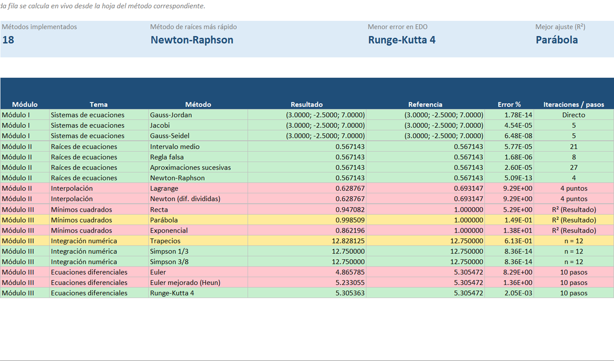
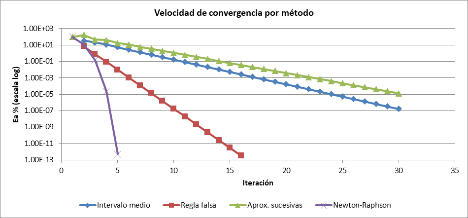
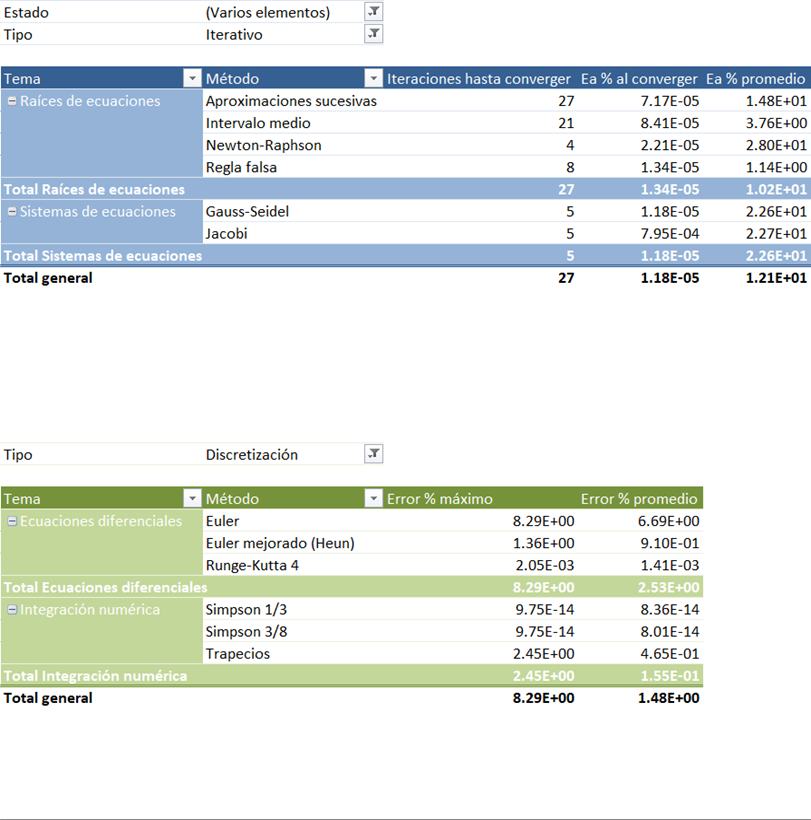
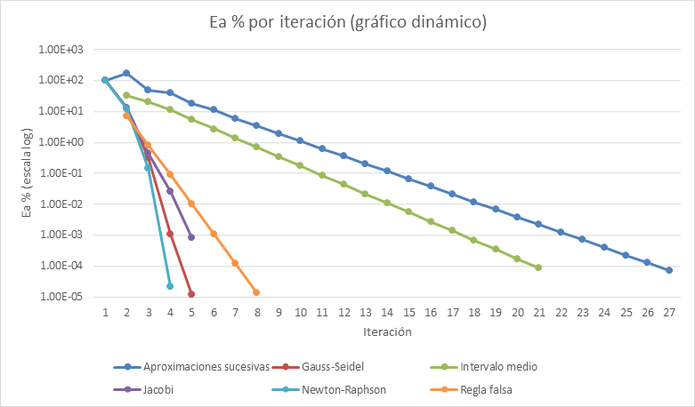
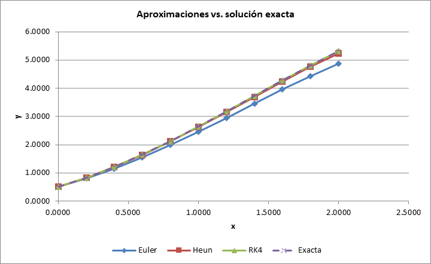
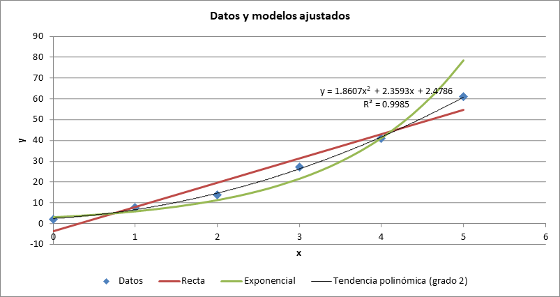
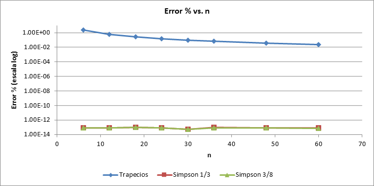

# 📊 Métodos Numéricos en Excel — Libro interactivo con LAMBDA, matrices y tablas dinámicas

Convertí el contenido de la asignatura **Métodos Numéricos para Ingenieros (0638, Universidad Tecnológica de Panamá)** en un libro de Excel donde **cada método se calcula con fórmulas vivas**: se cambian los datos de entrada y se recalculan todas las iteraciones, gráficos, resúmenes y tablas dinámicas. No usa macros (VBA), solo funciones y herramientas nativas de Excel.


📥 **Archivo:** [`MetodosNumericos_Excel.xlsx`](MetodosNumericos_Excel.xlsx)

---

## 📌 ¿Qué resuelve?

El curso tiene tres módulos. Implementé los métodos de cada uno y los comparé entre sí con los mismos datos:

| Módulo | Tema | Métodos implementados |
|---|---|---|
| I | Representación de números y teoría del error | Conversión decimal → binario/octal/hex por divisiones sucesivas, redondeo vs. truncamiento, error de truncamiento en la serie de Maclaurin de eˣ (criterio de Scarborough), error propagado |
| I | Sistemas de ecuaciones lineales | Solución directa con matrices (A⁻¹·c), **Gauss-Jordan** paso a paso, **Jacobi** y **Gauss-Seidel** |
| II | Raíces de ecuaciones | **Intervalo medio (bisección)**, **Regla falsa**, **Aproximaciones sucesivas** y **Newton-Raphson** |
| II | Interpolación | **Lagrange** y **Newton** (diferencias divididas) |
| III | Aproximación funcional | **Mínimos cuadrados**: recta, parábola y exponencial (linealizada) |
| III | Integración numérica | **Trapecios**, **Simpson 1/3** y **Simpson 3/8** |
| III | Ecuaciones diferenciales | **Euler**, **Euler mejorado (Heun)** y **Runge-Kutta de 4.º orden** |

Los ejemplos salen del material del curso: la raíz de `f(x) = e^(-x) − x` y la integral de `f(x) = x³ − 2x² + x + 2` en `[0, 3]` con 12 subintervalos (trapecios = **12.8281**, Simpson = **12.7500**, los mismos valores del material).

## 🧰 Herramientas de Excel aplicadas

| Herramienta | Dónde se usa |
|---|---|
| **Funciones LAMBDA con nombre** (Administrador de nombres) | `f_raiz`, `df_raiz`, `g_raiz`, `f_int`, `f_edo`, `y_exacta`: la función matemática se define **una sola vez** y todas las tablas la llaman. Al cambiarla se actualiza el libro completo |
| **LAMBDA personalizadas reutilizables** | `ERROR_REL(nuevo, anterior)` para el error relativo aproximado; `INTERP_LAGRANGE(xs, ys, t)` construida con `LET + SEQUENCE + MAP` |
| **Fórmulas de matriz dinámica** | `MMULT`, `MINVERSE`, `MDETERM`, `LINEST` con constantes matriciales `{1,2}`, `FILTER`, `SEQUENCE`, `TRANSPOSE` |
| **LET / XLOOKUP / XMATCH** | Detección automática de la iteración en la que cada método alcanza la tolerancia |
| **Tabla de datos (Análisis Y si)** | Sensibilidad del resultado de la integral al número de subintervalos `n` |
| **Tabla estructurada** | `tblConvergencia` registra todas las iteraciones con referencias estructuradas (`[@Método]`, `INDEX([Conv],1):[@Conv]`) |
| **Tablas dinámicas + gráficos dinámicos** | Iteraciones hasta converger, error al converger y error por iteración de cada método |
| **Segmentaciones de datos** | Filtros por tema y por método conectados a dos tablas dinámicas a la vez |
| **Formato condicional** | Filas que ya cumplen la tolerancia, barras de datos, escala de color para R², semáforo según el error, íconos |
| **Validación de datos** | Entradas con rango permitido y mensaje de ayuda (p. ej. `n` entre 1 y 60) |
| **Gráficos** | Dispersión con escala logarítmica, línea de tendencia polinómica con ecuación y R², series que se ajustan a `n` usando `NA()` |
| **Navegación** | Índice con hipervínculos, colores de pestaña por módulo, convención de celdas de entrada/resultado |

## 🗂️ Estructura del libro

| Hoja | Contenido |
|---|---|
| **Inicio** | Instrucciones, índice con hipervínculos y catálogo de funciones LAMBDA |
| **Resumen** | Resultado de los 18 métodos frente a su valor de referencia, con indicadores y semáforo de error |
| **Errores** | Módulo I: representación de números y teoría del error |
| **SEL** | Módulo I: sistemas de ecuaciones lineales |
| **Raíces** | Módulo II: cuatro métodos sobre la misma función y su curva de convergencia |
| **Interpolación** | Módulo II: estimación de ln(2) con Lagrange y Newton |
| **Ajuste** | Módulo III: ecuaciones normales resueltas con matrices y verificadas con `LINEST` |
| **Integración** | Módulo III: pesos dinámicos por método y Tabla de datos de sensibilidad |
| **EDO** | Módulo III: Euler, Heun y RK4 frente a la solución exacta |
| **Datos** | Tabla `tblConvergencia`, origen de las tablas dinámicas |
| **Análisis** | Tablas dinámicas, gráficos dinámicos y segmentaciones |

## 📈 Resultados

**Resumen de todos los métodos**



**Velocidad de convergencia en raíces**: Newton-Raphson converge en 4 iteraciones, la regla falsa en 8, la bisección en 21 y las aproximaciones sucesivas en 27 para la misma tolerancia.



**Tablas dinámicas y gráfico dinámico sobre `tblConvergencia`**





**Ecuaciones diferenciales**: el error final de RK4 es 0.002 %, frente a 1.36 % de Heun y 8.29 % de Euler con el mismo paso.



**Mínimos cuadrados**: la línea de tendencia de Excel coincide con la parábola calculada con las ecuaciones normales (R² = 0.9985).



**Integración: error vs. n** (Tabla de datos). Simpson es exacto para un polinomio cúbico, por eso su error queda en el nivel del redondeo de la máquina (~10⁻¹³ %).



## ▶️ Cómo usarlo

1. Abrir `MetodosNumericos_Excel.xlsx` en **Microsoft 365** o **Excel 2024** (las funciones `LAMBDA`, `LET`, `MAP` y `SEQUENCE` no existen en versiones anteriores).
2. Modificar solo las **celdas amarillas** (datos de entrada). Las **celdas verdes** son resultados.
3. Para resolver otra función: **Fórmulas → Administrador de nombres** → editar `f_raiz`, `df_raiz`, `g_raiz`, `f_int`, `f_edo` o `y_exacta`.
4. Después de cambiar parámetros, actualizar las tablas dinámicas con **Datos → Actualizar todo** (`Ctrl + Alt + F5`). También se actualizan al abrir el archivo.

## 🛠️ Regenerar el libro

El libro se construye con un script que automatiza Excel. El script solo arma la estructura; todos los cálculos quedan como fórmulas dentro del libro.

```bash
pip install pywin32 openpyxl
py scripts/generar_libro.py
```

Requiere Windows con Microsoft Excel instalado. También genera las imágenes de `docs/img/`.

## 📁 Estructura del repositorio

```
metodos-numericos-excel/
├── MetodosNumericos_Excel.xlsx   # Libro final
├── scripts/
│   └── generar_libro.py          # Construcción automatizada del libro (Excel COM)
├── docs/img/                     # Capturas de gráficos y tablas
└── README.md
```

## 👤 Autor

**Ernesto Jurado**, Universidad Tecnológica de Panamá.
